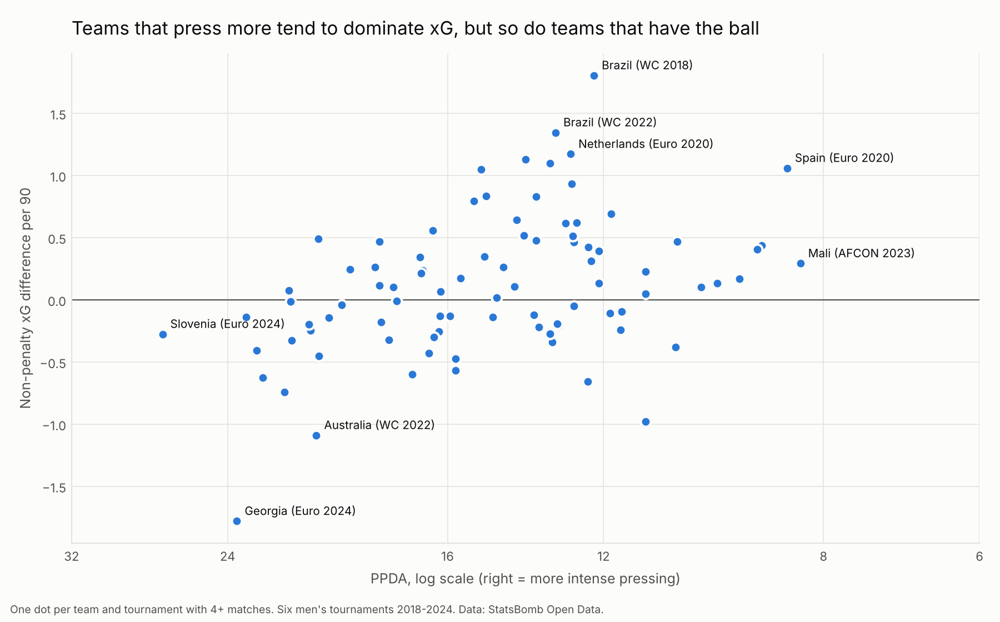
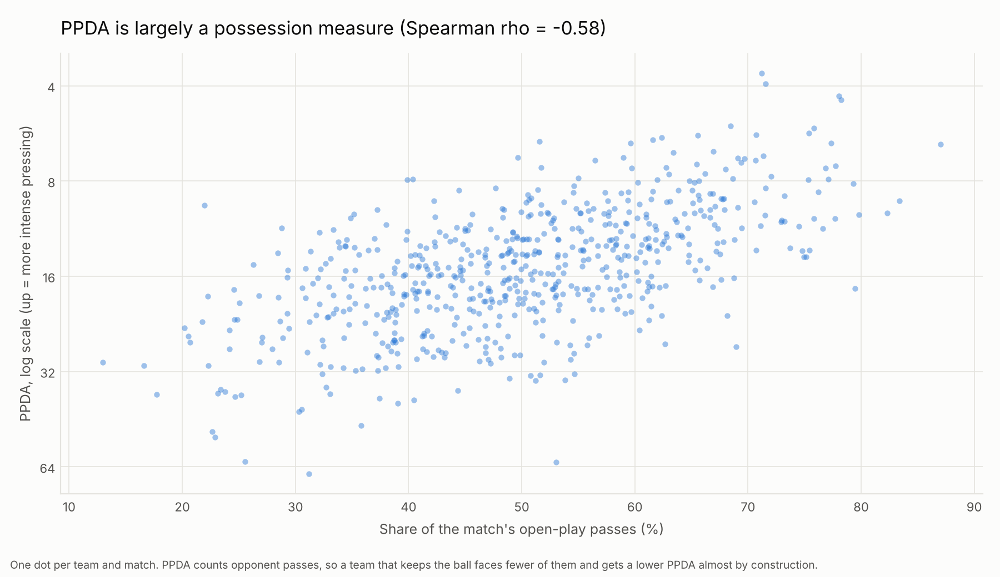
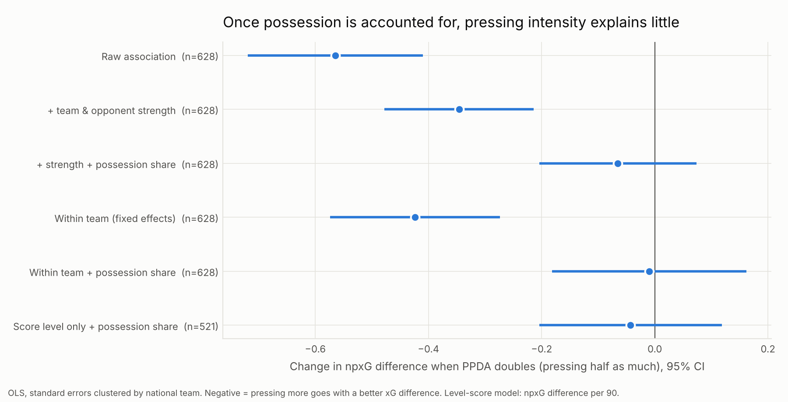
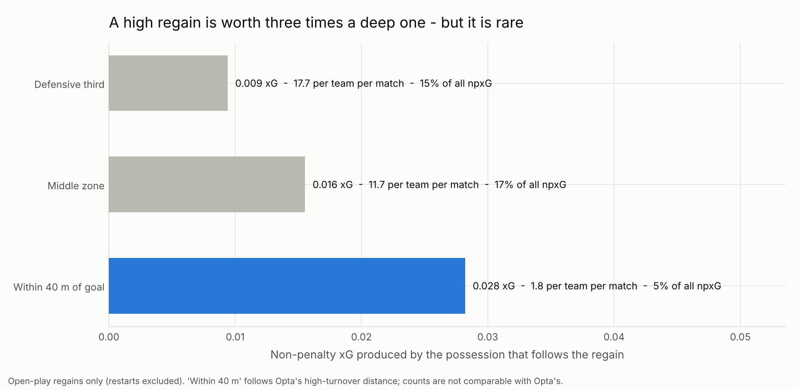

# WC22 · Does pressing pay off at international tournaments?

An event-data study of **314 matches from six men's tournaments (2018–2024)** using
StatsBomb Open Data: a DuckDB warehouse, automated data-quality checks, SQL feature
building and regression models in Python.

## The short answer

1. **Teams that press more do post better xG differences.** Halving PPDA (twice as many
   defensive actions per opponent pass) goes with **+0.57 non-penalty xG difference per
   match** (95% CI +0.41 to +0.72).
2. **Most of that is possession, not pressing.** PPDA moves with possession share
   (Spearman ρ = −0.58). With possession share in the model, the pressing effect falls to
   **+0.07 (CI −0.07 to +0.20)**. Comparing a team with itself across its matches, or
   counting only minutes played at a level score, gives the same result.
3. **The direct payoff of a high press is real but small.** A ball won within 40 m of the
   opponent's goal is worth **three times** a regain in the defensive third (0.028 vs 0.009
   npxG for the possession that follows). But teams manage only **1.8 such regains per
   match**, which is **5% of all non-penalty xG**.

**What this means:** at international tournaments, pressing intensity measured by PPDA adds
no detectable value beyond controlling the ball. It does **not** prove that pressing is
useless. Pressing may be one of the ways teams win possession, and if so its effect is
absorbed by the possession variable (see [Limitations](#limitations)). The defensible claim
is narrower: *a low PPDA mostly tells you who had the ball.*

## Findings



The raw picture: one dot per team and tournament. Spain at Euro 2020, the second most
intense presser, also dominated. But Brazil (2018 and 2022) and the Netherlands (Euro 2020)
dominated with only moderate pressing. Other intense pressers (Mali at AFCON 2023, Uruguay
and Brazil at the Copa) were only modestly positive.



The reason: PPDA counts opponent passes. A team that keeps the ball faces fewer of them,
so its PPDA drops almost by construction.



Negative effects mean that pressing more goes with a better xG difference.

| Model (outcome: npxG difference) | Effect of doubling PPDA | 95% CI |
|---|---|---|
| Raw association | −0.57 | −0.72 to −0.41 |
| + team & opponent strength | −0.35 | −0.48 to −0.21 |
| + strength + possession share | −0.07 | −0.20 to +0.07 |
| Within team (team-tournament fixed effects) | −0.42 | −0.57 to −0.27 |
| Within team + possession share | −0.01 | −0.18 to +0.16 |
| Level score only + possession share (per 90 level minutes) | −0.04 | −0.20 to +0.12 |

Every specification that includes possession share puts the pressing effect at about zero.
Every one that leaves it out finds a sizeable effect.



| Where the ball is won | Regains per team per match | Possessions ending in a shot | npxG per regain | Share of all npxG |
|---|---|---|---|---|
| Defensive third | 17.7 | 9% | 0.009 | 15% |
| Middle zone | 11.7 | 14% | 0.016 | 17% |
| Within 40 m of goal | 1.8 | 25% | 0.028 | 5% |

**By tournament**, the Copa América 2024 pressed the hardest (median PPDA 11.7) and Euro 2024
the least (17.9). Every table is in [reports/pressing/results.md](reports/pressing/results.md),
generated by the code.

## Data and quality checks

| Tournament | Matches |
|---|---|
| FIFA World Cup 2018 | 64 |
| FIFA World Cup 2022 | 64 |
| UEFA Euro 2020 | 51 |
| UEFA Euro 2024 | 51 |
| Copa América 2024 | 32 |
| Africa Cup of Nations 2023 | 52 |

Before any analysis, six automated checks run over the warehouse (`python -m fdl quality`).
On these 314 matches they find:

- **22 events with corrupted timestamps** in 18 matches, all `Ball Receipt*`. The game-state
  clock uses a running maximum, so these events neither add nor remove playing time.
- **189 inconsistent lineup position spells** in 31 matches: out of order or overlapping.
  Minutes and game states are therefore built from events, never from lineup clocks.
- **1 location 0.1 yd outside the pitch.**

Recomputed goals match the official score in all 628 team-matches, own goals included and
shoot-outs excluded.

## Method

| Concept | Definition |
|---|---|
| Unit | One team in one match (628 rows). Penalty shoot-outs are not playing time. |
| **PPDA** | Opponent open-play passes in its own defensive 60% ÷ the team's tackles, interceptions and fouls in its attacking 60%. Lower = more pressing. Models use log2(PPDA), so effects read "per doubling". |
| **Possession share** | The team's share of the match's open-play passes. |
| **Outcome** | Non-penalty xG difference, from StatsBomb's xG model. It is far less noisy than goals over 3 to 7 matches per team. |
| **Regain** | A possession won from the opponent in open play. Restarts are excluded: throw-ins, free kicks, goal kicks, corners, kick-offs, goalkeeper actions, drop balls. Its location is that of the team's first event. |
| **High regain** | A regain within 40 m of the opponent's goal line (Opta's high-turnover distance). Counts are not comparable with Opta's, whose possession definition differs. |
| **Team strength** | The team's mean npxG difference in its other matches of the same tournament (leave-one-out), so it never uses the match being explained. The same for the opponent. |
| **Game state** | Score before each event, from that team's side. "Level score only" recomputes PPDA, possession and npxG difference (per 90 level minutes) using only level-score events. Team-matches need 15+ level minutes and 3+ defensive actions. |
| **Models** | OLS with standard errors clustered by national team (statsmodels). |

All features are SQL views (`sql/10_game_state.sql`, `sql/11_regains.sql`,
`sql/12_team_match_pressing.sql`). The models and figures are in
`src/fdl/pressing.py`.

## Limitations

- **Possession may be a mediator, not only a confounder.** If pressing wins the ball back,
  pressing causes possession, and controlling for possession hides that path. These data
  cannot separate the two stories. What they show is that PPDA carries little information
  that possession share does not already carry.
- **PPDA is a crude pressing measure.** It ignores where and how fast teams press. StatsBomb's
  `Pressure` events (counter-pressing, pressures per opponent build-up) would measure intensity
  more directly. That is the next step.
- **Small samples per team.** National teams play 3 to 7 matches per tournament, so
  leave-one-out strength is noisy and team rankings are fragile.
- **Observational data.** Teams choose how much to press depending on the opponent and the
  score. Level-score models reduce the second problem but not the first.
- **xG, not goals.** The outcome measures chance quality as judged by StatsBomb's model. It
  says nothing about finishing.

## Reproduce

```bash
python -m venv .venv
source .venv/bin/activate              # Windows: .venv\Scripts\activate
pip install -e ".[dev]"
python -m fdl download                 # 6 tournaments, ~1.4 GB (add --with-360 for 360 frames)
python -m fdl build                    # data/warehouse.duckdb
python -m fdl quality                  # data-quality checks
python -m fdl report                   # figures and tables in reports/pressing/
streamlit run app/streamlit_app.py     # interactive version (Pressing page)
pytest                                 # tests run on 3 real matches (python -m fdl download --fixtures)
```

## Repository

| Path | Content |
|---|---|
| `src/fdl/ingest.py`, `warehouse.py` | Download StatsBomb JSON, build the DuckDB warehouse |
| `src/fdl/quality.py` | The six data-quality checks |
| `sql/` | Analytical SQL views: minutes played, passing, PPDA, game state, regains, team-match table |
| `src/fdl/pressing.py` | The pressing analysis: models, figures, generated report |
| `src/fdl/xg.py`, `xt.py` | Own xG model (log loss 0.282 on WC 2022, StatsBomb 0.267) and expected threat |
| `app/streamlit_app.py` | Streamlit app: pressing, match centre, data quality, xG, xT, player profiles |
| `tests/` | Tests on three deliberately awkward real matches |
| `docs/training/` | The self-training brief this project grew from, and milestone notes |

## Data

Data: [StatsBomb Open Data](https://github.com/statsbomb/open-data), used under its licence,
which requires attribution to StatsBomb.
